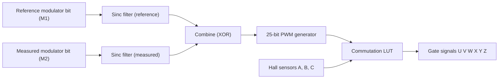
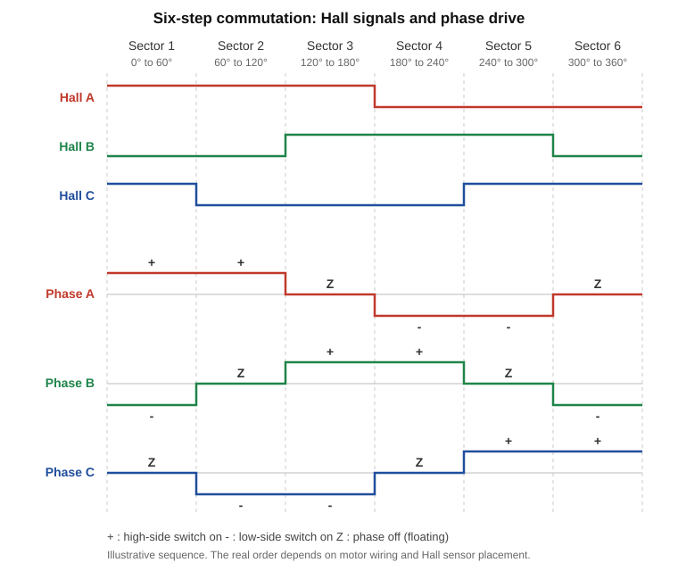
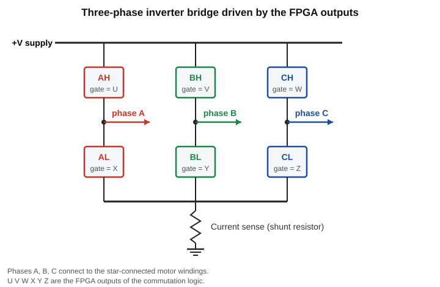
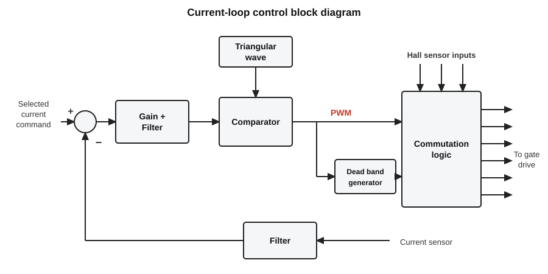
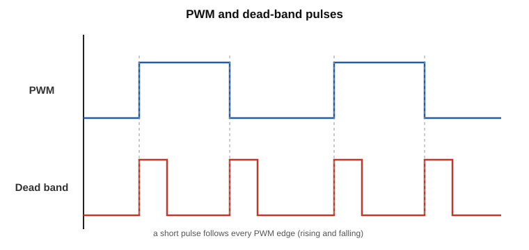

# PWM Current Loop in FPGA (BLDC motor drive)

VHDL design for the current-control path of a brushless DC (BLDC) motor drive, written during my project internship at the **Mixed-Signal Controller & Power Drives Division, Vikram Sarabhai Space Centre (VSSC/ISRO)**, Thiruvananthapuram, April to September 2021, under the guidance of Mr. Anish Gopinath.

The design reads motor current from a delta-sigma modulator, filters it digitally, compares it with a reference, generates a PWM signal and applies Hall-sensor block commutation to drive the six inverter gate signals.

> **Status:** verified in simulation only (ModelSim/ISE during the internship, GHDL for the commutation testbench). Not tested on FPGA hardware or with a real motor.

## Block diagram



## Files

| File | What it does |
|---|---|
| `src/Sinc_modulator_r.vhd`, `src/Sinc_modulator_m.vhd` | Third-order Sinc (CIC-style) decimation filters (25-bit). They turn the 1-bit delta-sigma stream into a number: reference and measured copies. |
| `src/PWM_generator.vhd` | `pwm_prog`: 25-bit programmable PWM. Period set by `i_pwm_module`, width by `i_pwm_width`, with a sync-reset input. |
| `src/Commutation_Logic.vhd` | `lut`: lookup table from the three Hall signals plus the PWM bit to the six gate outputs (block commutation). |
| `src/Connection_code.vhd` | `Circuit_VHDL`: top level connecting the filters, PWM generator and LUT. |
| `tb/commutation_logic_tb.vhd` | Testbench for the commutation LUT (all 32 input combinations, self-checking). |
| `docs/commutation_truth_table.pdf` | My control block diagram, dead-band sketch and commutation truth table. |

## How it works

1. **Current sensing.** An isolated delta-sigma modulator (the ADS1202/ADS1203 family) outputs a 1-bit stream. Each Sinc filter has three accumulator stages (counting the ones, then two more integrators) followed by three differencing stages, which gives a multi-bit value. This follows the approach in TI application report SBAA094 (references below).
2. **Error and duty.** The reference and measured values are combined (`CN5 <= Temp1 XOR Temp2` in `Connection_code.vhd`) and the result sets the PWM width.
3. **PWM.** `pwm_prog` counts up to `i_pwm_module` and holds the output high while the counter is below the width.
4. **Commutation.** The LUT combines Hall states A, B, C with the PWM bit and selects which of the six switches are driven.

## Project presentation (docs)

These figures explain what the FPGA logic is meant to do. Figures 1 to 4 are redrawn diagrams; figure 5 is page 3 of `docs/commutation_truth_table.pdf`, which also holds the original block diagram (page 1) and dead-band sketch (page 2).

### 1. Working principle



A BLDC motor has three Hall sensors (A, B, C). Over one electrical revolution (360 degrees) their on/off pattern changes six times, giving six sectors of 60 degrees. In each sector the controller drives one motor phase high, one low and leaves the third off (floating), so the rotor keeps turning. This is block (six-step) commutation. The sequence drawn here is illustrative; the real order depends on motor wiring and sensor placement.

### 2. Inverter bridge



The motor phases are driven by a three-phase bridge of six switches: three high-side (AH, BH, CH) and three low-side (AL, BL, CL), supplied from +V. A shunt resistor at the bottom is the current-sense point. The six FPGA outputs `U V W X Y Z` in the VHDL correspond to these six switches.

### 3. Control block diagram



The current loop works like this:
1. The selected current command is compared with the filtered measured current (from the current sensor).
2. The error goes through a gain and filter stage and is compared with a triangular wave, which produces the PWM signal.
3. A dead-band generator derives a dead-band signal from the PWM.
4. The commutation logic combines PWM, dead band and the three Hall inputs and produces the six gate-drive signals.

In the VHDL, the two Sinc filters process the reference and measured delta-sigma bit streams, the `pwm_prog` block generates the PWM, and the `lut` block is the commutation logic. The top level ties the dead-band input to the PWM signal, so there is no separate dead-band generator.

### 4. Dead band



Dead band is a short delay inserted around each PWM edge so the high-side and low-side switches of the same leg are never on at the same moment (which would short the supply). The sketch shows the PWM signal and the dead-band pulses at its edges.

### 5. Commutation truth table

Inputs: the three Hall-derived signals HAB, HBC, HCA, the dead-band signal DB and the PWM signal. Outputs: the six inverter switches (AH, BH, CH = high side, AL, BL, CL = low side). In the VHDL these are `a b c d e` and `u v w x y z`. Rows with DB = 1 or an invalid Hall state (000, 111) give all ones. Whether `1` means switch on or off is not stated in the source files (see limitations).

| # | HAB | HBC | HCA | DB | PWM | AH | BH | CH | AL | BL | CL |
|---|---|---|---|---|---|---|---|---|---|---|---|
| 1 | 0 | 0 | 0 | 0 | 0 | 1 | 1 | 1 | 1 | 1 | 1 |
| 2 | 0 | 0 | 0 | 0 | 1 | 1 | 1 | 1 | 1 | 1 | 1 |
| 3 | 0 | 0 | 0 | 1 | 0 | 1 | 1 | 1 | 1 | 1 | 1 |
| 4 | 0 | 0 | 0 | 1 | 1 | 1 | 1 | 1 | 1 | 1 | 1 |
| 5 | 0 | 0 | 1 | 0 | 0 | 1 | 1 | 0 | 0 | 1 | 1 |
| 6 | 0 | 0 | 1 | 0 | 1 | 0 | 1 | 1 | 1 | 1 | 0 |
| 7 | 0 | 0 | 1 | 1 | 0 | 1 | 1 | 1 | 1 | 1 | 1 |
| 8 | 0 | 0 | 1 | 1 | 1 | 1 | 1 | 1 | 1 | 1 | 1 |
| 9 | 0 | 1 | 0 | 0 | 0 | 1 | 0 | 1 | 1 | 1 | 0 |
| 10 | 0 | 1 | 0 | 0 | 1 | 1 | 1 | 0 | 1 | 0 | 1 |
| 11 | 0 | 1 | 0 | 1 | 0 | 1 | 1 | 1 | 1 | 1 | 1 |
| 12 | 0 | 1 | 0 | 1 | 1 | 1 | 1 | 1 | 1 | 1 | 1 |
| 13 | 0 | 1 | 1 | 0 | 0 | 1 | 0 | 1 | 0 | 1 | 1 |
| 14 | 0 | 1 | 1 | 0 | 1 | 0 | 1 | 1 | 1 | 0 | 1 |
| 15 | 0 | 1 | 1 | 1 | 0 | 1 | 1 | 1 | 1 | 1 | 1 |
| 16 | 0 | 1 | 1 | 1 | 1 | 1 | 1 | 1 | 1 | 1 | 1 |
| 17 | 1 | 0 | 0 | 0 | 0 | 0 | 1 | 1 | 1 | 0 | 1 |
| 18 | 1 | 0 | 0 | 0 | 1 | 1 | 0 | 1 | 0 | 1 | 1 |
| 19 | 1 | 0 | 0 | 1 | 0 | 1 | 1 | 1 | 1 | 1 | 1 |
| 20 | 1 | 0 | 0 | 1 | 1 | 1 | 1 | 1 | 1 | 1 | 1 |
| 21 | 1 | 0 | 1 | 0 | 0 | 1 | 1 | 0 | 1 | 0 | 1 |
| 22 | 1 | 0 | 1 | 0 | 1 | 1 | 0 | 1 | 1 | 1 | 0 |
| 23 | 1 | 0 | 1 | 1 | 0 | 1 | 1 | 1 | 1 | 1 | 1 |
| 24 | 1 | 0 | 1 | 1 | 1 | 1 | 1 | 1 | 1 | 1 | 1 |
| 25 | 1 | 1 | 0 | 0 | 0 | 0 | 1 | 1 | 1 | 1 | 0 |
| 26 | 1 | 1 | 0 | 0 | 1 | 1 | 1 | 0 | 0 | 1 | 1 |
| 27 | 1 | 1 | 0 | 1 | 0 | 1 | 1 | 1 | 1 | 1 | 1 |
| 28 | 1 | 1 | 0 | 1 | 1 | 1 | 1 | 1 | 1 | 1 | 1 |
| 29 | 1 | 1 | 1 | 0 | 0 | 1 | 1 | 1 | 1 | 1 | 1 |
| 30 | 1 | 1 | 1 | 0 | 1 | 1 | 1 | 1 | 1 | 1 | 1 |
| 31 | 1 | 1 | 1 | 1 | 0 | 1 | 1 | 1 | 1 | 1 | 1 |
| 32 | 1 | 1 | 1 | 1 | 1 | 1 | 1 | 1 | 1 | 1 | 1 |

This table is the one in `docs/commutation_truth_table.pdf` (page 3); the testbench checks all 32 rows against it.

## Simulation

The commutation testbench runs with [GHDL](https://github.com/ghdl/ghdl) (VHDL-93):

```bash
ghdl -a --std=93 src/Commutation_Logic.vhd tb/commutation_logic_tb.vhd
ghdl -e --std=93 commutation_logic_tb
ghdl -r --std=93 commutation_logic_tb --wave=lut.ghw   # view with: gtkwave lut.ghw
```

Expected output: `all 32 input combinations match`. The design was originally developed with Xilinx ISE and ModelSim.

## Known limitations and TODO

- The commutation testbench sweeps all 32 input combinations and passes in GHDL. Its expected values match the outputs of the truth table in `docs/commutation_truth_table.pdf` (compared from the extracted PDF text, so a look at the PDF itself is still worthwhile).
- In the top level `Circuit_VHDL`, `d` and `e` are both driven by the same PWM signal, so the combinations with `d = 0, e = 1` (DB = 0, PWM = 1) never occur there, and there is no separate dead-band generator in this design.
- No testbenches yet for the Sinc filters or the full top level.
- Gate polarity (active-high or active-low) and the XOR combination are as in my original code and are not documented further here.

## References

- Texas Instruments, *Combining the ADS1202 with an FPGA Digital Filter for Current Measurement in Motor Control Applications*, SBAA094 (2003).
- E. Hogenauer, *An Economical Class of Digital Filters for Decimation and Interpolation*, IEEE Trans. ASSP, 1981.
- Texas Instruments, *Speed Control of Brushless DC Motors: Block Commutation With Hall Sensors*, user's guide.

## License

MIT, see `LICENSE`.
# PWM-ControloopFPGA
